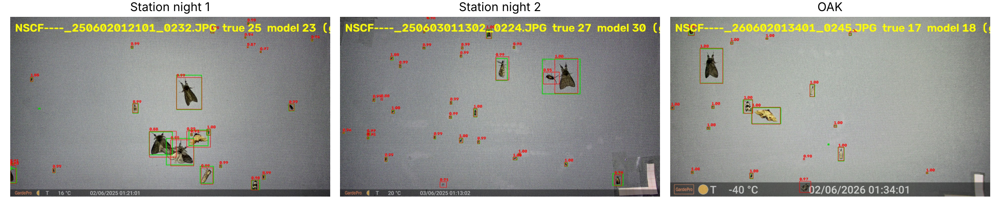

# Insect detection, counting and classification in light-trap images

Internship project (M.Sc. Artificial Intelligence, BTU Cottbus-Senftenberg), supervised by Prof. Birkhofer.

An automatic light trap photographs an illuminated sheet once per minute through the night. This project builds a
two-stage pipeline that **finds and counts every insect** in a frame and **assigns the larger moths to a taxon**,
evaluated on three nights from two sites (OAK, Station night 1, Station night 2).



## Pipeline

| Stage | Method |
|---|---|
| Annotation | 120 frames per night hand-annotated in CVAT (one class, "insect"), 360 frames in total |
| Split | each night cut into 10 time blocks: 6 train / 2 validation / 2 test, one gap frame at each border |
| Detector | Faster R-CNN ResNet50-FPN v2 (torchvision, COCO-pretrained), anchors from the measured box sizes |
| Two inputs compared | **tiled**: 1280 px tiles (overlap 704 px) from the half-resolution frame; **whole frame**: the frame shrunk to 1280 x 720 |
| Counting | score threshold chosen on the validation frames (lowest count error), test frames scored once |
| Classifier | ResNet-18 (ImageNet-pretrained) on crops of insects larger than 100 px; rare taxa merged into "other insect" |
| Pooled model | one detector trained on the train/val frames of all three nights, scored on each night's own test frames |

## Results (test frames, 24 per night)

| | Station night 1 | Station night 2 | OAK |
|---|---|---|---|
| AP50 tiled / whole frame | 0.678 / 0.810 | 0.850 / 0.940 | 0.840 / 0.874 |
| F1 tiled / whole frame | 0.753 / 0.810 | 0.873 / 0.932 | 0.842 / 0.876 |
| Count MAE per frame, tiled / whole frame | 6.25 / 4.00 | 1.33 / 0.92 | 1.62 / 1.38 |
| AP50 pooled model (whole frame) | 0.798 | 0.935 | 0.853 |
| Count MAE pooled model (whole frame) | 3.54 | 0.54 | 1.46 |

- The whole-frame model beats the tiled model on all three nights and is about 50x faster (0.1 s vs 5 s per frame).
- One pooled whole-frame model is about as accurate as three per-night models and counts better on both Station nights.
- Classifier: test accuracy 0.971, macro-F1 0.968 on 140 crops (5 classes). Crops of the same moth on neighbouring
  frames are correlated, so this overstates how well it generalises to new individuals.

Full numbers are in [`results/`](results), figures in [`figures/`](figures) and the write-up in [`report/`](report).

## Repository layout

```
src/        pipeline scripts (s00-s12) and the notebook that runs them
results/    per-night results, pooled-model results and classifier results (summaries, curves)
figures/    figures used in the report
report/     internship report (PDF)
```

## Running it

The data (camera frames and annotations) belong to the lab and are not included.

1. `pip install -r requirements.txt` (install PyTorch for your CUDA version first, see pytorch.org).
2. Set `raw_dir`, `work_dir` and `cvat_coco` in `src/config.py`.
3. Run `src/run_pipeline.ipynb` cell by cell: frame check, label validation, split, tiles, training,
   inference, evaluation and error analysis (s00-s08).
4. Classification: `s09_crops.py` cuts the crops, `s10_classifier.py` trains and evaluates the classifier.
5. Pooled model: `s12_pooled.run(cfg, BASE)` after s00-s04 have been run for each night.

The runs reported here used an RTX A2000 (6 GB) with `batch_size=1`, `down_factor=4` (whole frame 1280 x 720),
30 epochs and mixed precision, set in the first notebook cell.
